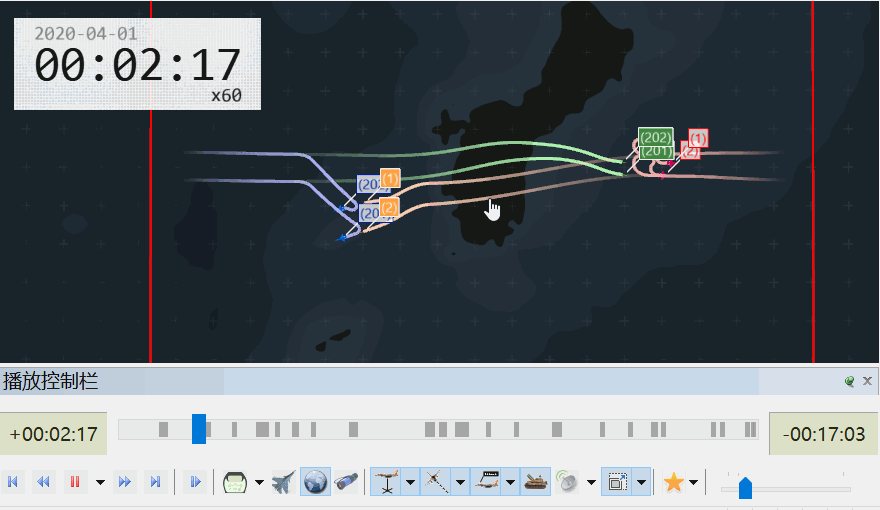
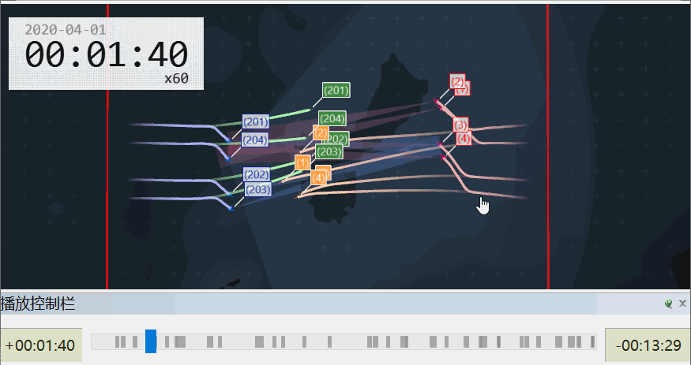
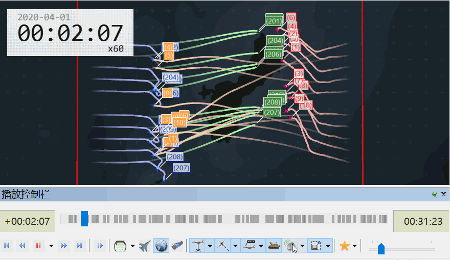
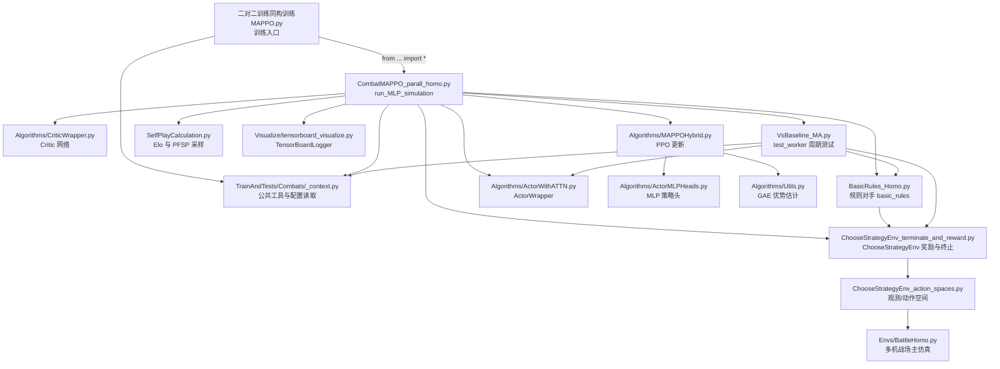
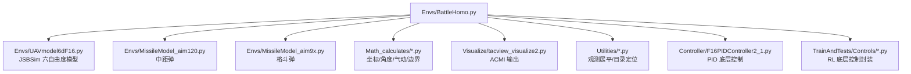
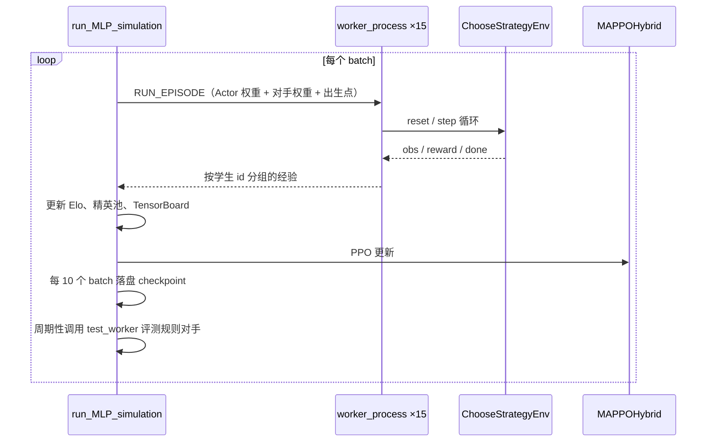

# 多机空战强化学习（Multi-UAV Air Combat RL）

基于 **JSBSim 六自由度飞控** + **MAPPO 同构自博弈** 的多机空战训练框架，支持 多对多 红蓝对抗、PFSP 对手池自博弈、TacView 可视化回放与 TensorBoard 训练监控。

本项目当前的主训练入口为 [`TrainAndTests/Combats/二对二训练同构训练MAPPO.py`](TrainAndTests/Combats/二对二训练同构训练MAPPO.py)，本文档以该入口为起点，梳理它的完整调用链。

---

## 目录

- [环境要求](#环境要求)
- [快速开始](#快速开始)
- [初步结果](#初步结果)
- [调用关系总览](#调用关系总览)
- [分层说明与文件职责](#分层说明与文件职责)
- [训练主循环时序](#训练主循环时序)
- [配置与产物](#配置与产物)
- [其他入口](#其他入口)

---

## 环境要求

| 项 | 说明 |
| --- | --- |
| Python | 3.8+（推荐 Conda 环境 `38`） |
| 关键依赖 | `torch`、`numpy`、`jsbsim`、`gym`、`shapely`、`tensorboard` |
| 可视化 | TacView（ACMI 实时推送）、TensorBoard |
| 操作系统 | Windows（脚本路径与多进程启动方式按 Windows 配置） |

```bash
conda activate 38
python TrainAndTests/Combats/二对二训练同构训练MAPPO.py
```

---

## 初步结果

以下为不同规模对抗下的训练后自博弈片段（TacView 回放录制）。

| 2v2 | 4v4 | 10v10 |
| --- | --- | --- |
|  |  |  |

---

## 调用关系总览

从入口脚本出发的模块依赖（箭头表示 `import` / 调用方向）：



`BattleHomo.py` 再向下依赖底层仿真与数学模块：



---

## 分层说明与文件职责

### 1. 入口层

| 文件 | 职责 |
| --- | --- |
| [`TrainAndTests/Combats/二对二训练同构训练MAPPO.py`](TrainAndTests/Combats/二对二训练同构训练MAPPO.py) | 仅做两件事：定义超参数，然后调用 `run_MLP_simulation(...)`。可指定 `resume_target_dir` 续训。 |

入口向训练核心传递的关键参数：

```text
dt_decide = 2                 # 决策周期（秒）
dt_maneuver = 2               # 环境步长（秒）
dt_move = 0.07                # 物理积分步长（秒）
MAX_HISTORY_SIZE = 50         # 精英池中 NN 快照容量
compete_old_rate = 0.2        # 规则复习概率
K_FACTOR = 16                 # Elo 更新系数
self_play_type = 'PFSP_balanced'
vertices = init_states.json['vertices']
```

### 2. 训练主循环层

| 文件 | 关键符号 | 职责 |
| --- | --- | --- |
| [`CombatMAPPO_parall_homo.py`](TrainAndTests/Combats/CombatMAPPO_parall_homo.py) | `run_MLP_simulation` | 训练总控：起 15 个 worker、收集经验、PPO 更新、周期测试、Elo 记账、对手池维护、日志与存档。 |
| 同上 | `worker_process` | 单进程采样：建环境、加载红方共享 Actor 与蓝方对手权重、跑满一回合、回传按 id 分组的经验。 |
| 同上 | `create_initial_state_worker` | 随机化红蓝出生点与航向。 |
| [`TrainAndTests/Combats/_context.py`](TrainAndTests/Combats/_context.py) | `load_init_states` / `load_obs_dims` / `append_experience` / `stack_field` | 共享工具：读 `init_states.json`、读 `env_obs_dims.json`、经验拼接与观测堆叠。 |
| [`SelfPlayCalculation.py`](TrainAndTests/Combats/SelfPlayCalculation.py) | `calculate_expected_score` / `update_elo` / `get_opponent_probabilities` | Elo 公式与对手采样概率（PFSP 高斯核、规则复习分支）。 |

### 3. 算法层

| 文件 | 关键符号 | 职责 |
| --- | --- | --- |
| [`Algorithms/ActorWithATTN.py`](Algorithms/ActorWithATTN.py) | `ActorWrapper` | 红蓝共用的策略网络，输出连续机动动作、离散目标选择与开火伯努利。 |
| [`Algorithms/CriticWrapper.py`](Algorithms/CriticWrapper.py) | `critic_wrapper` | 集中式价值网络。 |
| [`Algorithms/MAPPOHybrid.py`](Algorithms/MAPPOHybrid.py) | `MAPPOHybrid` | 混合动作空间的 PPO 更新。 |
| [`Algorithms/ActorMLPHeads.py`](Algorithms/ActorMLPHeads.py) | `ActorMLPWrapper` / `ActorMLPHeads` | 策略网络的 MLP 头实现。 |
| [`Algorithms/Utils.py`](Algorithms/Utils.py) | `compute_advantage` | GAE 优势与回报估计。 |

### 4. 环境层

| 文件 | 关键符号 | 职责 |
| --- | --- | --- |
| [`Envs/Tasks/ChooseStrategyEnv_terminate_and_reward.py`](Envs/Tasks/ChooseStrategyEnv_terminate_and_reward.py) | `ChooseStrategyEnv` | 在动作空间之上加**奖励塑形与胜负平判定**。 |
| [`Envs/Tasks/ChooseStrategyEnv_action_spaces.py`](Envs/Tasks/ChooseStrategyEnv_action_spaces.py) | `get_obs` | 构造个体观测（`ego_main` / `ego_control` / `radar_info` / `RWR_infos` / `border` 等）。 |
| [`Envs/BattleHomo.py`](Envs/BattleHomo.py) | `Battle` | 战场主仿真：出生、导弹、雷达、边界、渲染、`step` 推进。 |
| [`Envs/UAVmodel6dF16.py`](Envs/UAVmodel6dF16.py) | `UAVModel` | JSBSim F-16 六自由度模型。 |
| [`Envs/MissileModel_aim120.py`](Envs/MissileModel_aim120.py) | — | 中距弹三自由度模型。 |
| [`Envs/MissileModel_aim9x.py`](Envs/MissileModel_aim9x.py) | `aim9x` | 近距格斗弹模型。 |

### 5. 规则对手与测试

| 文件 | 关键符号 | 职责 |
| --- | --- | --- |
| [`BasicRules_Homo.py`](TrainAndTests/Combats/BasicRules_Homo.py) | `basic_rules` | Rule_0 ~ Rule_3 等脚本化对手策略。 |
| [`VsBaseline_MA.py`](TrainAndTests/Combats/VsBaseline_MA.py) | `test_worker` | 用固定规则对手做周期评测，生成 `test_vs_rules.csv`。 |

### 6. 支撑层

| 文件 | 职责 |
| --- | --- |
| [`Math_calculates/sub_of_angles.py`](Math_calculates/sub_of_angles.py) | 角度归一化。 |
| [`Math_calculates/Calc_dist2border.py`](Math_calculates/Calc_dist2border.py) | 圆形/多边形边界距离与左右侧判定。 |
| [`Math_calculates/CartesianOnEarth.py`](Math_calculates/CartesianOnEarth.py) | NUE 与经纬高互转。 |
| [`Visualize/tacview_visualize2.py`](Visualize/tacview_visualize2.py) | ACMI 协议输出。 |
| [`Visualize/tensorboard_visualize.py`](Visualize/tensorboard_visualize.py) | `TensorBoardLogger.add(tag, value, step)`。 |

---

## 训练主循环时序



要点：

- **决策节奏**：`action_cycle_multiplier = dt_decide / dt_maneuver`，只有整数倍步才进入决策分支。
- **对手来源**：`elite_elo_ratings`（4 条规则 + 至多 `MAX_HISTORY_SIZE` 个 NN 快照）。规则永不淘汰，NN 满员时淘汰池内 Elo 最弱者。
- **准入校验**：只有磁盘上存在对应 `.pt` 的版本才允许入池；采样到缺失权重会直接抛错，不再静默降级。
- **Elo**：仅对已入池对手记账，`main_agent_elo` 持久化在 `available_opps.json` 的 `__CURRENT_MAIN__`。

---

## 配置与产物

### 输入配置（`TrainAndTests/Combats/`）

| 文件 | 内容 |
| --- | --- |
| `init_states.json` | 红蓝初始数量、挂载数、出生点、场地 `vertices`。训练与测试共用同一份。 |
| `env_obs_dims.json` | 观测维度（fixed / enm / ally），由环境读取脚本生成。 |

### 运行产物（`logs/combat/<mission_name>-run-<timestamp>/`）

| 文件 | 内容 |
| --- | --- |
| `actor_rein<batch>.pt` | 周期性策略快照；`actor_rein0.pt` 为初始策略，续训时不会被覆盖。 |
| `critic.pt` | 价值网络。 |
| `available_opps.json` | 可行对手注册表（名称 → 版本号），以及 `__CURRENT_MAIN__` 等训练元数据。 |
| `elite_elo_ratings.json` | 精英池快照（名称 → Elo）。 |
| `fire_records_buffer.pkl` | 开火/命中监督缓冲。 |
| `test_vs_rules.csv` | 周期测试对规则对手的胜/负/平与得分。 |
| TensorBoard events | `train/*`、`train_plus/*`、`behavior/*`、`Elo/*` 等曲线。 |

---

## 其他入口

本 README 只展开同构 MAPPO 训练这一条链。仓库中还存在若干独立入口：

| 文件 | 用途 |
| --- | --- |
| `TrainAndTests/Combats/VsBaseline_MA_with_homo_test.py` | 同构模型针对性测试。 |
| `TrainAndTests/Combats/CombatPPOWithIL3_parallel_hierarch.py` | 分层决策 PPO 训练。 |
| `TrainAndTests/Combats/CombatMAPPO_parall_hetero.py` | 异构 MAPPO 训练核心（需配合入口脚本调用）。 |
| `TrainAndTests/Combats/BasicRules_Homo.py` | 规则对手定义。 |

> 对比算法与 baseline 复现须遵循 [`对比算法构建代码规范.md`](对比算法构建代码规范.md) 与 [`AGENTS.md`](AGENTS.md)。

---

## License

见 [LICENSE](LICENSE)。
